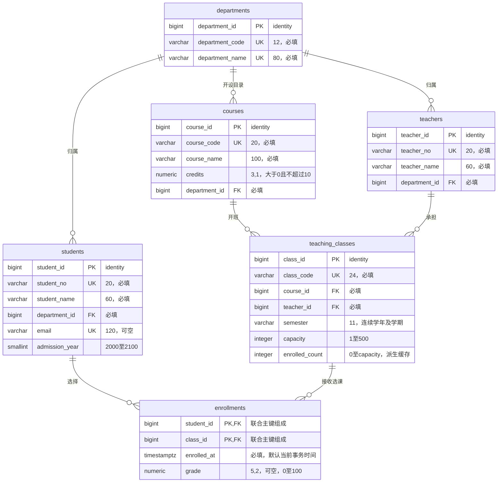
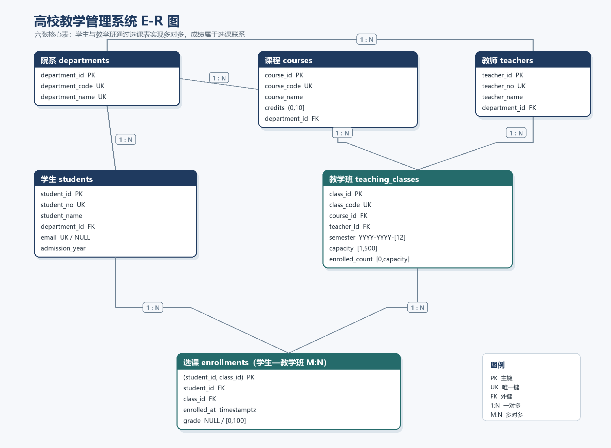

# 高校教学管理系统概念设计

## 1. 建模范围与依据

模型包括院系、学生、教师、课程、教学班五个独立实体，以及带属性的选课关联实体，共映射为六张核心表。学生和教学班构成多对多联系；选课时间和成绩描述这次联系，因此放在 `enrollments` 中。

课程目录与教学班分离，避免每次开班复制课程学分和名称。一门课程可以跨学期重复开设，也可以在同学期由不同教学班开设。教师与课程之间的实际授课联系通过教学班表达，不再增加没有独立业务属性的授课表。

## 2. 实体、属性与候选键

候选键是能唯一标识记录且不含多余属性的最小属性集。各候选键均以规定的唯一性、非空性和业务语义为依据，不能因为当前样本没有重名就把姓名当成候选键。

| 实体/关联 | 属性 | 候选键 | 选定主键 | 属性可选性 |
|---|---|---|---|---|
| 院系 `departments` | `department_id`、`department_code`、`department_name` | `{department_id}`、`{department_code}`、`{department_name}` | `department_id` | 全部必填 |
| 学生 `students` | `student_id`、`student_no`、`student_name`、`department_id`、`email`、`admission_year` | `{student_id}`、`{student_no}` | `student_id` | 仅 `email` 可空 |
| 教师 `teachers` | `teacher_id`、`teacher_no`、`teacher_name`、`department_id` | `{teacher_id}`、`{teacher_no}` | `teacher_id` | 全部必填 |
| 课程 `courses` | `course_id`、`course_code`、`course_name`、`credits`、`department_id` | `{course_id}`、`{course_code}` | `course_id` | 全部必填 |
| 教学班 `teaching_classes` | `class_id`、`class_code`、`course_id`、`teacher_id`、`semester`、`capacity`、`enrolled_count` | `{class_id}`、`{class_code}` | `class_id` | 全部必填；人数默认 0 |
| 选课 `enrollments` | `student_id`、`class_id`、`enrolled_at`、`grade` | `{student_id, class_id}` | `(student_id, class_id)` | 仅 `grade` 可空；时间有默认值 |

`email` 即使非空值受唯一性约束，也因为允许多条 `NULL`，不能作为覆盖全体学生的候选键。课程名称、学生姓名、教师姓名和学期均不唯一。`(course_id, teacher_id, semester)` 也没有被规定为唯一，同一组合仍可以开设不同代码的教学班。

前五个实体的代理 ID 是 `bigint` identity，业务编号是备用候选键。代理键减少业务编号变化对引用的影响，但不取代业务编号的唯一约束。identity 本身不是一对一联系的依据。

## 3. 联系、基数和参与可选性

| 联系 | 父侧可关联数量 | 子侧必须关联数量 | 语义与外键 |
|---|---|---|---|
| 院系—学生 | 一个院系对应 0 至多个学生 | 一个学生恰属 1 个院系 | `students.department_id` 非空外键 |
| 院系—教师 | 一个院系对应 0 至多个教师 | 一个教师恰属 1 个院系 | `teachers.department_id` 非空外键 |
| 院系—课程 | 一个院系对应 0 至多门课程 | 一门课程恰属 1 个院系 | `courses.department_id` 非空外键 |
| 课程—教学班 | 一门课程对应 0 至多个教学班 | 一个教学班恰属 1 门课程 | `teaching_classes.course_id` 非空外键 |
| 教师—教学班 | 一位教师对应 0 至多个教学班 | 一个教学班由 1 位教师承担 | `teaching_classes.teacher_id` 非空外键 |
| 学生—选课 | 一个学生有 0 至多条选课 | 每条选课对应 1 个学生 | `enrollments.student_id` 非空外键及主键组成部分 |
| 教学班—选课 | 一个教学班有 0 至多条选课，且受容量上界限制 | 每条选课对应 1 个教学班 | `enrollments.class_id` 非空外键及主键组成部分 |

学生—教学班在概念层面为 `0..N : 0..N` 的多对多联系，经选课关联实体转换为两个一对多联系。选课的最大条数受每个教学班的容量限制，普通 Mermaid 基数只表达“多”，数值上界由业务规则和数据库触发器补充。

本场景没有业务依据充分的一对一联系，不为满足图形种类而拆分学生档案或增设账号实体。院系无学生、课程尚未开班、教师尚未授课、学生尚未选课、教学班尚无人选，都是合法状态。

## 4. E-R 图

图中 `||` 表示恰好一个，`o{` 表示零个或多个；实体字段后的 `PK`、`FK`、`UK` 分别标识主键、外键、唯一约束。选课表的两个字段共同构成主键，单独一个字段不能唯一标识选课记录。



该代码用于支持 Mermaid 的 Markdown 阅读器渲染；图中长度和约束为注释，完整定义以逻辑及物理设计为准。



## 5. 属性归属与冗余判断

### 5.1 选课时间与成绩

同一学生选择不同教学班会产生不同选课时间和成绩；同一教学班也有多名学生、各自成绩不同。因此这两个属性由 `(student_id, class_id)` 整体确定，不能放进学生或教学班实体。

跨学期重修会对应不同教学班，从而保留为不同选课记录。同课程同学期选择不同班也不受当前模型禁止；模型只拒绝同一学生、同一教学班的重复关系。

### 5.2 人数缓存

`enrolled_count` 是教学班的派生缓存，其业务值等于：

```text
某教学班人数 = enrollments 中 class_id 等于该教学班 ID 的记录数
```

概念上可以不存储而实时聚合；当前为了容量竞争时能够对教学班行执行条件原子更新而保留。它与选课明细之间有跨表冗余，由选退课触发器维护，另由 `DEFERRABLE INITIALLY DEFERRED` 约束触发器 `trg_verify_enrollment_count` 在提交时强制核对真实条数，并可通过聚合审计复核。不能因为它位于教学班表中就认为单表 `CHECK` 已保证其正确。

### 5.3 不增加的依赖

不推断“学生院系决定所选课程院系”“教师院系必须等于课程院系”“同一课程一个学期只有一班”。这些命题既不是当前业务约束，也不能当成函数依赖用于分解。

不把学生、教师、教务员的业务称谓视为已存在的登录账号，也不把教师 ID 当成认证信息。当前模型没有账号、角色绑定或访问控制实体。

## 6. 设计复核清单与证据边界

| 复核项 | 本文的设计处理 | 正式提交前应提供的核验 |
|---|---|---|
| 实体数及实际意义 | 五个独立实体加一个选课关联实体 | 对照六表建表脚本及实际数据库 |
| 多对多转换 | 学生—教学班经选课表转换 | 重复选课拒绝和正常多条关联数据 |
| 可选性 | 除邮箱、成绩外必填；父侧可无子记录 | 空值约束测试及 `LEFT JOIN` 结果 |
| 候选键 | 仅使用有非空唯一依据的最小键 | 重复业务编号拒绝测试 |
| 关系属性 | 时间和成绩存放在选课关系 | 同一学生多门课程的不同成绩样例 |
| 跨表冗余 | 人数缓存明示为冗余，提交时有强制一致性校验 | 选退课、直接篡改提交被拒绝、回滚及并发后的计数审计 |

上述可观察项中的重复业务编号、正常与重复选课、满班拒绝、选退课计数、直接篡改提交和并发争抢最后名额已由 2026-11-18 的自动化测试实际覆盖；`LEFT JOIN` 与八类查询也已实际执行。候选键和联系基数仍须由学生逐项人工审核，自动化测试不能替代业务语义确认。
